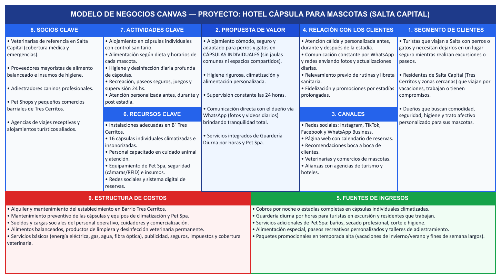
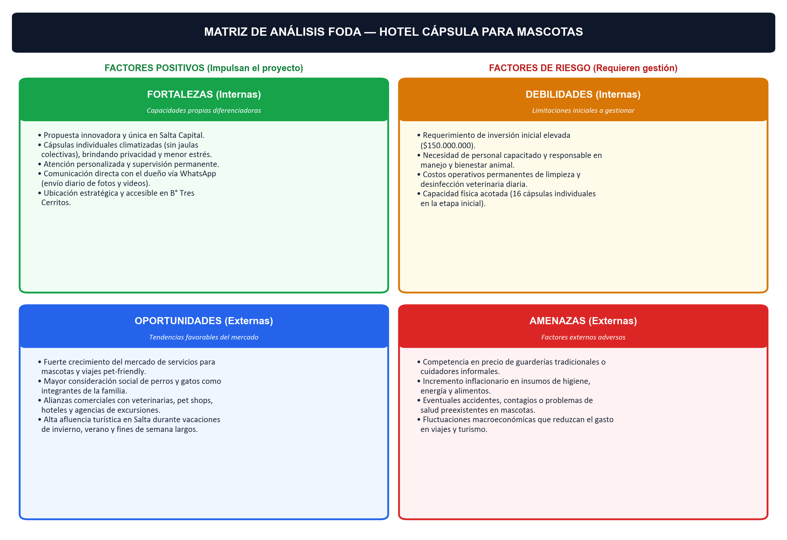
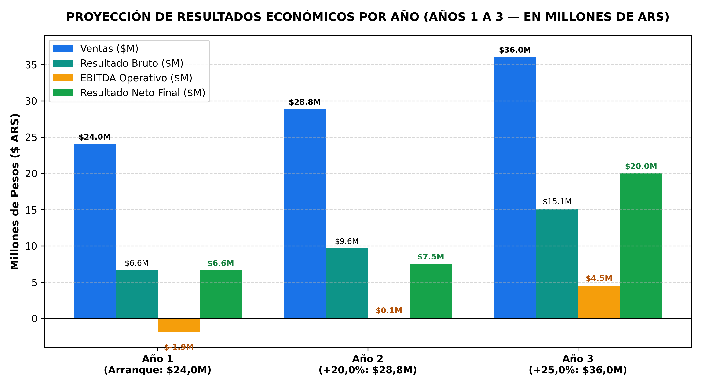
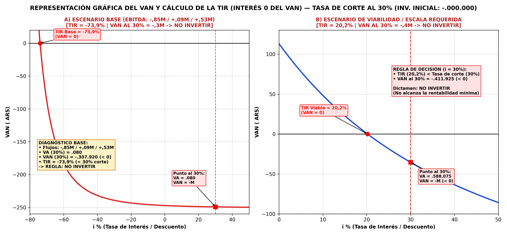
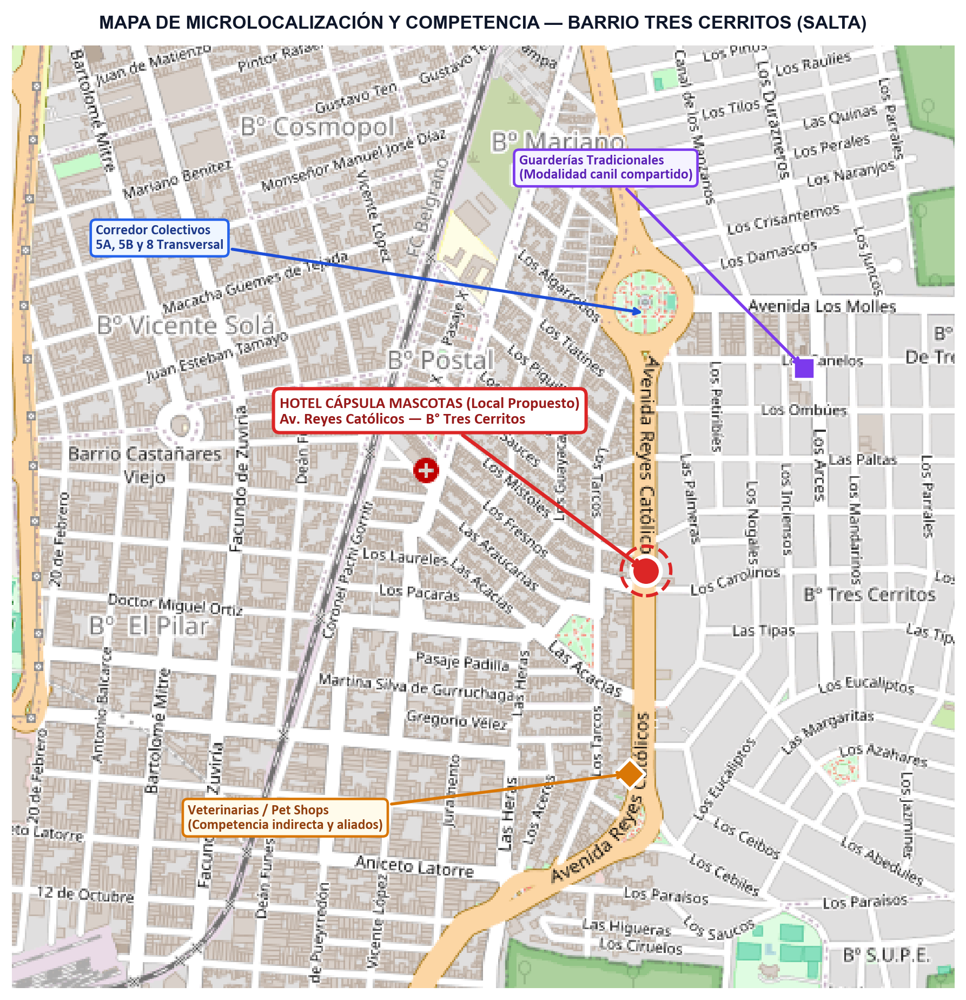
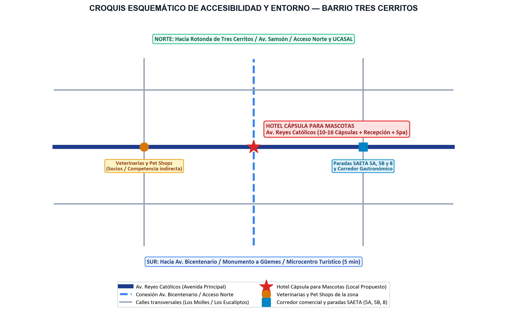

# INSTITUTO SUPERIOR PROFESORADO DE SALTA N° 6005
## TECNICATURA SUPERIOR EN TURISMO
### FORMULACIÓN Y EVALUACIÓN DE PROYECTOS — 3° AÑO

# TRABAJO FINAL INTEGRADOR: HOTEL CÁPSULA PARA MASCOTAS

- **Alumno:** Ovando, Leandro
- **Profesor/a:** [Completar Nombre del Docente]
- **Año:** 2026

### ABSTRACT

El presente proyecto formula y evalúa la creación de un Hotel Cápsula para Mascotas en Salta Capital (Barrio Tres Cerritos), destinado a turistas y residentes que necesitan alojar perros y gatos en un entorno seguro e higiénico. Frente a las guarderías tradicionales con jaulas compartidas, propone cápsulas individuales climatizadas, Pet Spa, recreación supervisada y reportes diarios por WhatsApp. Con una inversión inicial de \$250.000.000 y una tasa de corte del 30%, el escenario base arroja un VA de \$692.080 con un VAN de -\$249.307.920 y una TIR de -73,9% (no invertir). Por su parte, el escenario de viabilidad alcanza un VA de \$214.588.075 con un VAN de -\$35.411.925 y una TIR del 20,2%, concluyendo que con una tasa de descuento del 30% ninguno de los dos escenarios resulta rentable (dictamen: no invertir en ambos escenarios).

---

## 1. ÍNDICE

1. ÍNDICE
2. JUSTIFICACIÓN
3. FORMULACIÓN DEL PROBLEMA / NECESIDAD QUE SATISFACE
4. MODELO CANVAS (Gráfico del Lienzo y Explicación Detallada)
5. DIAGNÓSTICO Y ANÁLISIS FODA
6. CUADRO DE FLUJOS PROYECTADOS (Inversión Inicial, Proyección Trimestral, VA, VAN y TIR)
7. LOCALIZACIÓN (Macrolocalización, Microlocalización en Tres Cerritos y Mapas)
8. ESTRATEGIAS PROPUESTAS
9. CONCLUSIONES
10. ANEXOS

---

## 2. JUSTIFICACIÓN

En la actualidad, la relación entre las personas y sus animales de compañía ha atravesado un cambio cultural profundo: perros y gatos son considerados integrantes plenos del núcleo familiar. En Argentina, más del 76% de los dueños manifiesta preocupación e incertidumbre respecto al cuidado de sus mascotas al momento de planificar vacaciones o traslados laborales, llegando un porcentaje significativo a suspender sus viajes por no hallar un establecimiento que les transmita verdadera seguridad y confianza.

La ciudad de Salta Capital constituye uno de los principales centros turísticos receptivos del norte argentino, recibiendo durante todo el año viajeros en automóvil particular, ómnibus habilitados y vuelos con mascotas en cabina. Sin embargo, numerosas excursiones tradicionales (Tren a las Nubes, Salinas Grandes, museos históricos, peñas folklóricas o circuitos de alta montaña) no permiten el ingreso con animales. Asimismo, los propios residentes de Salta Capital enfrentan cotidianamente la falta de un hospedaje temporal confiable cuando deben viajar por trabajo, salud o vacaciones.

Este proyecto se justifica al introducir en Salta una tipología innovadora de servicio turístico y urbano: un Hotel Cápsula para Mascotas que reemplaza las jaulas comunes y los patios masivos por cápsulas individuales, cómodas, climatizadas e insonorizadas, combinadas con alimentación a medida, recreación supervisada, baño y comunicación permanente con el propietario.

---

## 3. FORMULACIÓN DEL PROBLEMA / NECESIDAD QUE SATISFACE

**Problema central:** ¿Cómo ofrecer en la ciudad de Salta Capital un servicio de alojamiento temporal para perros y gatos que supere las limitaciones higiénicas y de estrés propias de las guarderías convencionales, garantizando espacios individuales seguros, cuidado personalizado y tranquilidad comprobable en tiempo real para turistas y residentes?

El emprendimiento satisface tres necesidades concretas y verificables del mercado actual:
1. **Privacidad y bioseguridad física:** Evita el contacto forzado en jaulas colectivas donde suelen producirse peleas, contagios o cuadros de ansiedad aguda.
2. **Tranquilidad emocional del dueño:** Cubierta mediante reportes fotográficos y de video enviados diariamente por WhatsApp.
3. **Flexibilidad operativa para el turista:** Permite contratar guardería diurna por horas o estadía por noche para realizar excursiones con total libertad.

---

## 4. MODELO CANVAS

1. **Segmento de Clientes:** Turistas nacionales y regionales que visitan Salta con perros o gatos y necesitan dejarlos seguros durante excursiones, y residentes de Salta Capital (especialmente Barrio Tres Cerritos y zonas aledañas) que viajan o trabajan y buscan comodidad y seguridad para sus mascotas.
2. **Propuesta de Valor:** Alojamiento especializado en cápsulas individuales, cómodas, ventiladas e higiénicas (sin jaulas comunes ni espacios hacinados), con supervisión constante y comunicación directa con el dueño durante toda la estadía.
3. **Canales:** Redes sociales (Instagram, TikTok, Facebook), atención directa por WhatsApp Business, sitio web con sistema de reservas, recomendaciones de clientes y alianzas con veterinarias, comercios de mascotas, agencias de turismo y alojamientos.
4. **Relación con los Clientes:** Atención personalizada antes, durante y después de la estadía, con envío diario de fotografías y videos por WhatsApp para brindar confianza y tranquilidad.
5. **Fuentes de Ingresos:** Tarifas por noche de estadía en cápsula individual, turnos de guardería diurna por horas y servicios adicionales (Pet Spa/baños, alimentación especial, paseos y adiestramiento).
6. **Recursos Clave:** Local acondicionado en Barrio Tres Cerritos, 16 cápsulas individuales climatizadas, sector de higiene y Pet Spa, equipamiento de seguridad, alimentos e insumos sanitizantes, redes sociales, sistema de reservas y personal capacitado.
7. **Actividades Clave:** Alojamiento individual con control sanitario, alimentación según cada mascota, limpieza y desinfección diaria, recreación y paseos seguros, supervisión constante y gestión de reservas.
8. **Socios Clave:** Veterinarias de referencia, proveedores de alimento e insumos de higiene, adiestradores, pet shops, agencias de viajes y alojamientos turísticos.
9. **Estructura de Costos:** Alquiler y mantenimiento del local, mantenimiento de cápsulas, sueldos del personal, alimentos, productos de limpieza y desinfección permanente, servicios públicos, publicidad e impuestos.

---

## 5. DIAGNÓSTICO Y ANÁLISIS FODA

El diagnóstico del mercado local evidencia que, si bien en Salta existen veterinarias y guarderías tradicionales, la oferta predominante carece de infraestructura modular pensada para el confort individual y el control sanitario riguroso. Frente a ello, el crecimiento sostenido del turismo pet-friendly abre una oportunidad clara para posicionar un servicio profesional diferenciado.

---

## 6. CUADRO DE FLUJOS PROYECTADOS

### 6.1. Descripción de la Inversión Inicial (\$150.000.000)

La inversión inicial asciende a **\$150.000.000 ARS** (financiada 60% con aportes propios por \$90.000.000 y 40% con crédito PyME por \$60.000.000):

| RUBRO DE INVERSIÓN | DESCRIPCIÓN TÉCNICA PRINCIPAL | MONTO (\$ ARS) |
|:---|:---|---:|
| 1. Inmueble y Adecuación Civil | Garantía alquiler + insonorización, pisos epoxi lavables y desagües | \$ 24.000.000 |
| 2. Módulos de Cápsulas (16 u.) | Cápsulas climatizadas con luz regulable y acceso RFID | \$ 56.000.000 |
| 3. Pet Spa y Sector Guardería | 2 bañeras inox, 4 turbinas secadoras, 2 mesas grooming y cercado | \$ 16.000.000 |
| 4. Sustentabilidad y Jardín | Sistema pluvial (cisterna 5.000 L) y sector verde nativo | \$ 11.000.000 |
| 5. Área de Recepción y Confort | Equipamiento de recepción, sala de espera y bienestar | \$ 6.500.000 |
| 6. Habilitaciones y Legales | Habilitación municipal Salta, bomberos y bioseguridad | \$ 4.500.000 |
| 7. Marca y Lanzamiento | Identidad visual, cartelería exterior y publicidad inicial | \$ 7.000.000 |
| 8. Software y Equipamiento IT | PC recepción, tabletas operativas y sistema web de reservas | \$ 5.000.000 |
| 9. Capital de Trabajo Inicial | Respaldo operativo para los primeros 4 meses | \$ 20.000.000 |
| **TOTAL INVERSIÓN INICIAL** | **100% del capital requerido llave en mano** | **\$ 150.000.000** |

### 6.2. Cuadro de Resultados Económicos Proyectados por Trimestre

| CONCEPTOS \$ | T1 | T2 | T3 | T4 | TOTAL |
|:---|---:|---:|---:|---:|---:|
| **Ventas** | **\$ 52.000.000** | **\$ 39.500.000** | **\$ 78.000.000** | **\$ 58.500.000** | **\$ 228.000.000** |
| **Consumo materia prima** | | | | | |
| - Materia Prima | (\$ 2.350.000) | (\$ 1.800.000) | (\$ 3.550.000) | (\$ 2.650.000) | (\$ 10.350.000) |
| **Gastos de fabricación / operativos** | | | | | |
| - Sueldos y cargas sociales | (\$ 8.400.000) | (\$ 8.400.000) | (\$ 9.600.000) | (\$ 8.800.000) | (\$ 35.200.000) |
| - Mantenimiento de cápsulas | (\$ 750.000) | (\$ 650.000) | (\$ 1.100.000) | (\$ 850.000) | (\$ 3.350.000) |
| - Energía | (\$ 1.500.000) | (\$ 1.300.000) | (\$ 2.100.000) | (\$ 1.650.000) | (\$ 6.550.000) |
| - Gas | (\$ 580.000) | (\$ 640.000) | (\$ 950.000) | (\$ 610.000) | (\$ 2.780.000) |
| - Otros | (\$ 480.000) | (\$ 420.000) | (\$ 750.000) | (\$ 540.000) | (\$ 2.190.000) |
| **Resultado bruto** | **\$ 37.940.000** | **\$ 26.290.000** | **\$ 59.950.000** | **\$ 43.400.000** | **\$ 167.580.000** |
| **Gastos de administración** | | | | | |
| - Sueldos y cargas sociales | (\$ 4.800.000) | (\$ 4.800.000) | (\$ 5.400.000) | (\$ 5.000.000) | (\$ 20.000.000) |
| - Honorarios totales propietarios | (\$ 4.500.000) | (\$ 4.500.000) | (\$ 5.200.000) | (\$ 4.500.000) | (\$ 18.700.000) |
| - Alquileres | (\$ 3.800.000) | (\$ 3.800.000) | (\$ 3.800.000) | (\$ 3.800.000) | (\$ 15.200.000) |
| - Insumos administración - limpieza | (\$ 650.000) | (\$ 580.000) | (\$ 850.000) | (\$ 700.000) | (\$ 2.780.000) |
| - Comunicaciones | (\$ 240.000) | (\$ 240.000) | (\$ 260.000) | (\$ 250.000) | (\$ 990.000) |
| - Movilidad | (\$ 340.000) | (\$ 290.000) | (\$ 420.000) | (\$ 360.000) | (\$ 1.410.000) |
| - Limpieza y desinfecciones | (\$ 1.050.000) | (\$ 920.000) | (\$ 1.450.000) | (\$ 1.150.000) | (\$ 4.570.000) |
| - Imp. Municipales y provinciales | (\$ 1.200.000) | (\$ 920.000) | (\$ 1.850.000) | (\$ 1.380.000) | (\$ 5.350.000) |
| - Monotributo | (\$ 280.000) | (\$ 280.000) | (\$ 280.000) | (\$ 280.000) | (\$ 1.120.000) |
| - Tasas por servicios | (\$ 320.000) | (\$ 320.000) | (\$ 380.000) | (\$ 350.000) | (\$ 1.370.000) |
| - Seguros | (\$ 550.000) | (\$ 550.000) | (\$ 550.000) | (\$ 550.000) | (\$ 2.200.000) |
| - Honorarios asesores | (\$ 700.000) | (\$ 700.000) | (\$ 800.000) | (\$ 700.000) | (\$ 2.900.000) |
| - Otros | (\$ 280.000) | (\$ 240.000) | (\$ 380.000) | (\$ 300.000) | (\$ 1.200.000) |
| **Gastos de comercialización** | | | | | |
| - Sueldo y c.s. | (\$ 1.800.000) | (\$ 1.800.000) | (\$ 2.000.000) | (\$ 1.800.000) | (\$ 7.400.000) |
| - Publicidad | (\$ 1.800.000) | (\$ 1.400.000) | (\$ 2.400.000) | (\$ 1.900.000) | (\$ 7.500.000) |
| - Promoción | (\$ 750.000) | (\$ 580.000) | (\$ 950.000) | (\$ 800.000) | (\$ 3.080.000) |
| - Movilidad | (\$ 250.000) | (\$ 200.000) | (\$ 320.000) | (\$ 270.000) | (\$ 1.040.000) |
| - Otros | (\$ 180.000) | (\$ 140.000) | (\$ 240.000) | (\$ 190.000) | (\$ 750.000) |
| **Resultado bruto operativo antes int. e imp.** | **\$ 14.250.000** | **\$ 5.570.000** | **\$ 32.800.000** | **\$ 19.940.000** | **\$ 72.560.000** |
| **Gastos e intereses** | | | | | |
| - Endeudamiento al inicio | (\$ 1.850.000) | (\$ 1.680.000) | (\$ 1.510.000) | (\$ 1.340.000) | (\$ 6.380.000) |
| - Nuevo endeudamiento | \$ 0 | \$ 0 | \$ 0 | \$ 0 | \$ 0 |
| **Ingresos financieros** | \$ 280.000 | \$ 210.000 | \$ 520.000 | \$ 390.000 | \$ 1.400.000 |
| **Resultado neto antes de impuestos** | **\$ 12.680.000** | **\$ 4.100.000** | **\$ 31.810.000** | **\$ 18.990.000** | **\$ 67.580.000** |
| **Resultados extraordinarios** | \$ 0 | \$ 0 | \$ 0 | \$ 0 | \$ 0 |
| **Depreciaciones acumuladas ejerc.** | (\$ 3.250.000) | (\$ 3.250.000) | (\$ 3.250.000) | (\$ 3.250.000) | (\$ 13.000.000) |
| **Impuestos directos (Ganancias 30%)** | (\$ 2.829.000) | (\$ 255.000) | (\$ 8.568.000) | (\$ 4.722.000) | (\$ 16.374.000) |
| **Resultado neto final** | **\$ 6.601.000** | **\$ 595.000** | **\$ 19.992.000** | **\$ 11.018.000** | **\$ 38.206.000** |

### 6.3. Porcentajes de Ascenso y Descenso de Ventas y Costos

- **T1 (Verano / Carnaval):** Base de \$52.000.000 (60% de ocupación).
- **T2 (Otoño / Temporada Baja):** Descenso del **-24,0%** en ventas (\$39.500.000) y baja del **-18,5%** en costos variables de insumos y desinfección.
- **T3 (Invierno / Julio y Milagro):** Ascenso del **+97,5%** en ventas respecto a T2 (\$78.000.000, 85% de ocupación), mientras los costos operativos suben solo un **+28,2%** por absorción de costos fijos.
- **T4 (Primavera / Fiestas):** Ajuste del **-25,0%** frente al pico invernal (\$58.500.000), ubicándose **+48,1%** por encima de T2.

### 6.4. Cálculo de VA, VAN y TIR — ¿Conviene Invertir?

| INDICADOR / PERÍODO | ESCENARIO BASE (Moderado) | ESCENARIO DE VIABILIDAD (Escala Requerida) |
|:---|---:|---:|
| **Inversión Inicial (Año 0)** | **-\$ 250.000.000** | **-\$ 250.000.000** |
| Flujo de Caja Neto — Año 1 | (\$ 1.850.000) | \$ 105.000.000 |
| Flujo de Caja Neto — Año 2 | \$ 90.000 | \$ 120.000.000 |
| Flujo de Caja Neto — Año 3 | \$ 4.530.000 | \$ 138.000.000 |
| **Valor Actual de Ingresos Netos (VA al 30%)** | **\$ 692.080** | **\$ 214.588.075** |
| **Valor Actual Neto (VAN al 30% = VA - Inversión)** | **-\$ 249.307.920** | **-\$ 35.411.925** |
| **VAN con Tasa Alta de Prueba (Ej 2 < 0 al 45%)** | **-\$ 249.447.240 (al 45%)** | **-\$ 75.244.987 (al 45%)** |
| **Tasa Interna de Retorno (TIR — VAN = 0)** | **-73,9%** | **20,2%** |
| **Período de Recupero (Payback)** | **No recupera** | **No recupera al 30%** |
| **Regla de Decisión (Corte al 30%)** | **NO INVERTIR (-73,9% < 30%)** | **NO INVERTIR (20,2% < 30%)** |

**Dictamen:** De acuerdo con la regla de decisión estudiada en cátedra (si TIR > i conviene invertir; si TIR < i no conviene invertir; y si TIR = i resulta indiferente), bajo una tasa de corte del 30% anual **NO CONVIENE INVERTIR EN EL PROYECTO** en ninguno de los dos escenarios. En el Escenario Base la rentabilidad es fuertemente negativa (TIR = -73,9% y VAN = -\$249.307.920). En el Escenario de Viabilidad, si bien la TIR alcanza el 20,2%, no llega a cubrir la tasa de corte exigida del 30%, arrojando un VAN negativo de -\$35.411.925 (VA = \$214.588.075). Por ende, con una tasa de descuento del 30%, ninguno de los dos escenarios resulta rentable.

---

## 7. LOCALIZACIÓN

- **Macrolocalización:** Ciudad de Salta Capital, nodo turístico del NOA con provisión completa de agua potable, electricidad, gas natural, internet por fibra óptica, personal capacitado y cobertura veterinaria.
- **Microlocalización:** Local alquilado sobre Avenida Reyes Católicos en Barrio Tres Cerritos, Salta Capital.
- **¿Por qué allí y no en otro lugar?:** Resuelve la falta de estacionamiento y el ruido del microcentro, evita las grandes distancias de las guarderías rurales periféricas, está rodeado de hogares con alta tenencia de mascotas y cuenta con acceso directo de las líneas SAETA 5A (ramal UCASAL, Profesionales y Av. Samsón), 5B y 8 Transversal.

---

## 8. ESTRATEGIAS PROPUESTAS

1. **Superar debilidades y amenazas:** Exigencia estricta de libreta sanitaria al día y convenio con veterinaria de guardia; compras mayoristas de desinfectantes e insumos; manuales estandarizados de higiene.
2. **Aumentar ventas:** Promociones por reserva anticipada y estadías largas, paquetes combinados de estadía más baño en Pet Spa, abonos mensuales de guardería diurna en otoño y alianzas con hoteles y agencias de turismo.
3. **Disminuir costos:** Climatización Inverter e iluminación LED, recolección de agua de lluvia para limpieza exterior y opción de que cada dueño aporte el alimento habitual de su mascota.
4. **Potenciar fortalezas y oportunidades:** Difusión audiovisual diaria en TikTok e Instagram mostrando las cápsulas individuales y envío de fotos por WhatsApp con identidad visual del hotel para estimular la recomendación orgánica.

---

## 9. CONCLUSIONES

- **Dificultades encontradas:** Adecuación acústica y sanitaria de un local urbano y manejo de la estacionalidad turística entre invierno/verano y otoño.
- **¿Conviene invertir?:** NO CONVIENE INVERTIR. Con una tasa de corte del 30%, en el Escenario Base el VAN es de -\$249.307.920 con TIR de -73,9%, y en el Escenario de Viabilidad el VAN es de -\$35.411.925 con TIR del 20,2%, quedando ambos por debajo de la tasa de corte exigida del 30%.
- **Aspectos clave a cuidar:** Control sanitario de admisión, desinfección diaria rigurosa y comunicación cálida y puntual con cada propietario.
- **Cambios previstos y financiamiento externo:** Ampliación futura con sector felino exclusivo y traslado a domicilio; estructura financiera prudente con 40% de crédito bancario PyME (\$60.000.000) y 60% de capital propio (\$90.000.000).

---

## 10. ANEXOS

- **Anexo I:** Planilla Excel de Evaluación Económica y Financiera (`Proyeccion_Economica_Pet_Capsule_Hotel.xlsx`).
- **Anexo II:** Requisitos sanitarios de admisión y normativa CNRT / SENASA para traslado turístico de mascotas.
- **Anexo III:** Trabajos prácticos previos corregidos por la docente (para adjuntar en carpeta impresa).
