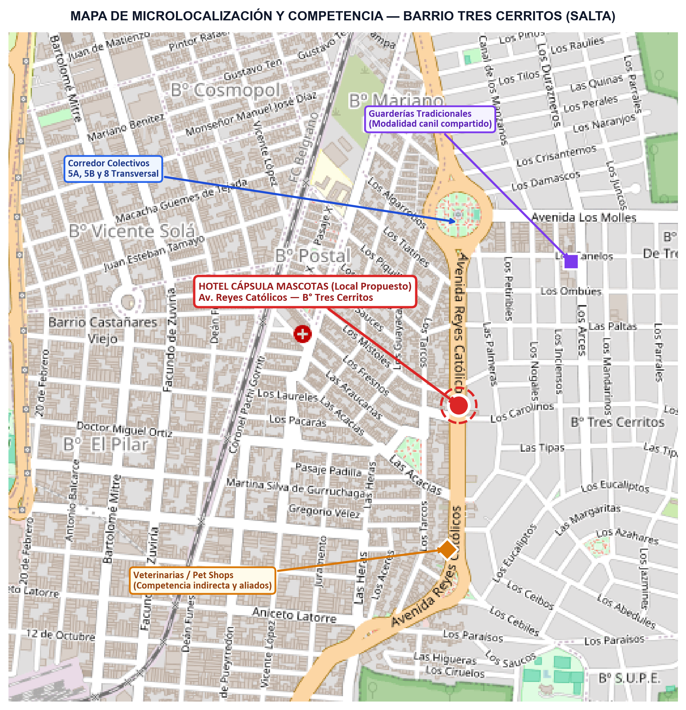
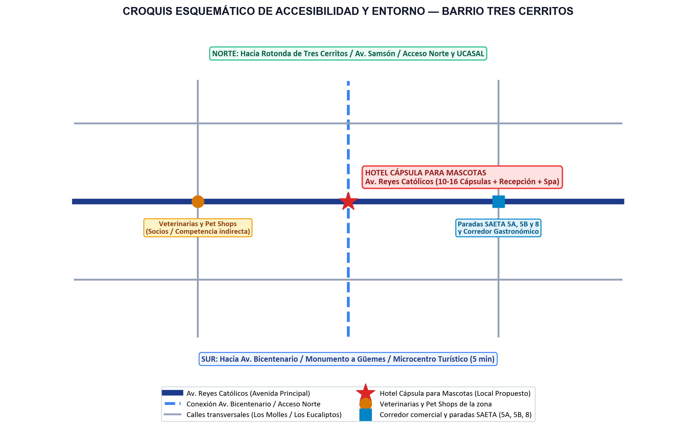

# MAPA DE LOCALIZACIÓN Y COMPETENCIA — BARRIO TRES CERRITOS

- **Estado:** Completado e integrado con cartografía y croquis vectorial
- **Zona de Emplazamiento:** Avenida Reyes Católicos, Barrio Tres Cerritos, Salta Capital
- **Líneas de Transporte Público:** SAETA 5A (ramal UCASAL, Profesionales y Av. Samsón), 5B y 8 Transversal

