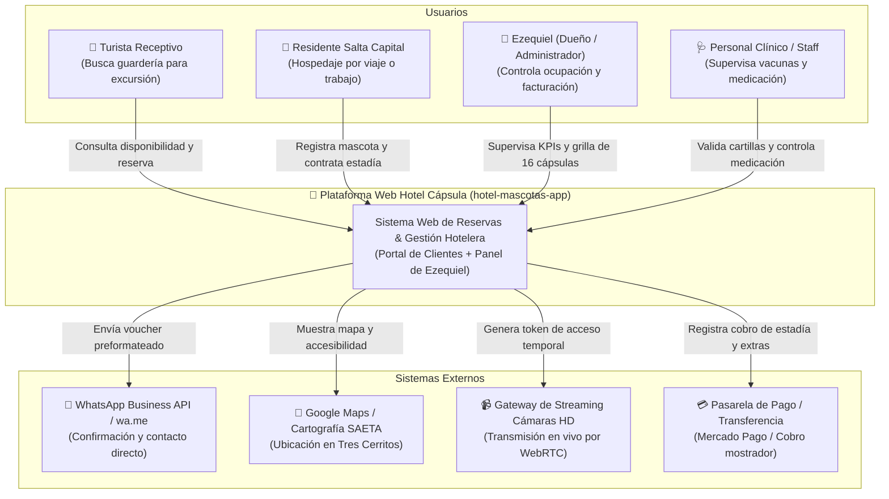
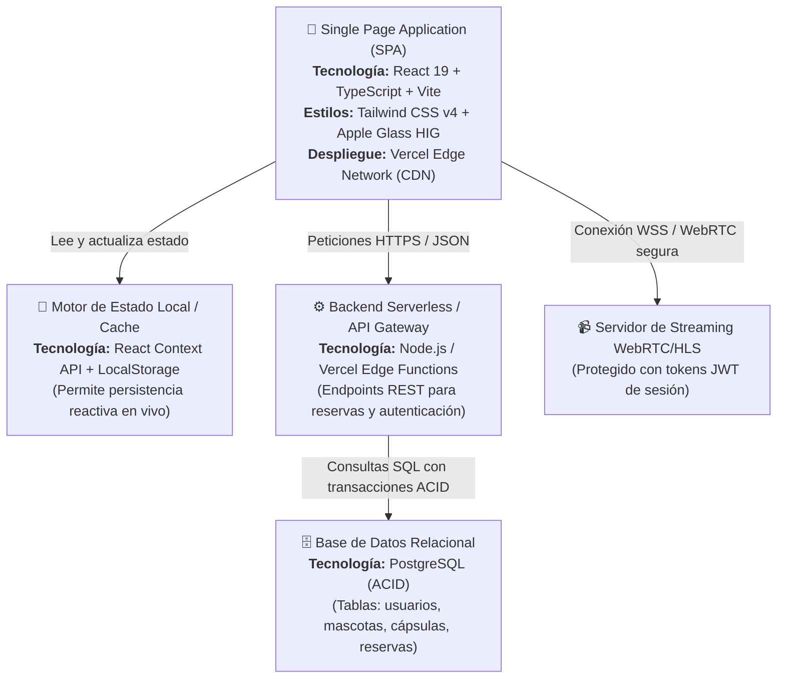
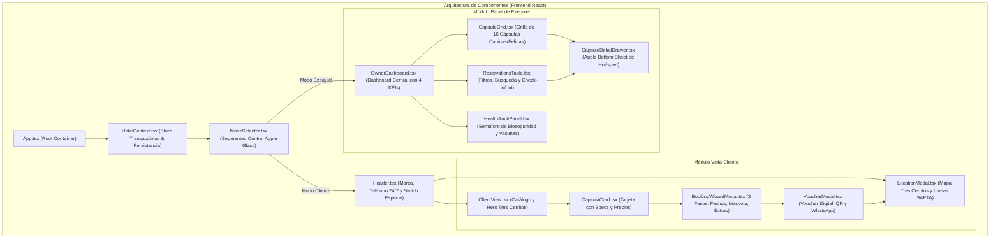

# 🏗️ Arquitectura de Software: Modelo C4 & Estrategias de Concurrencia
## Plataforma Web Hotel Cápsula para Mascotas - Salta Capital
**Metodología:** Modelo C4 (Contexto, Contenedores, Componentes, Código)  
**Normas de Referencia:** ISO/IEC/IEEE 42010 / IEEE 1016  
**Fecha:** Noviembre 2026  

---

## 1. Nivel 1: Diagrama de Contexto del Sistema

El siguiente diagrama define los límites del sistema, los usuarios principales y las interacciones con sistemas externos:



---

## 2. Nivel 2: Diagrama de Contenedores

Detalla los entornos de ejecución, protocolos de comunicación y tecnologías seleccionadas:



---

## 3. Nivel 3: Diagrama de Componentes del Frontend

Desglose de los módulos internos que componen la aplicación cliente/dueño:



---

## 4. Estrategia de Concurrencia y Control Anti-Overbooking

Uno de los mayores riesgos en la gestión hotelera es la colisión de fechas (*overbooking*), donde dos usuarios intentan reservar la misma cápsula simultáneamente.

### 4.1. Mecanismo de Bloqueo Pesimista (*Pessimistic Locking*)
En el modelo relacional de producción (PostgreSQL), la confirmación de una reserva se ejecuta mediante una transacción serializada con bloqueo de fila:

```sql
BEGIN TRANSACTION;

-- 1. Verificar disponibilidad y bloquear la cápsula seleccionada
SELECT id, estado 
FROM capsulas 
WHERE id = :capsula_id 
  AND id NOT IN (
      SELECT capsula_id 
      FROM reservas 
      WHERE estado IN ('CONFIRMADA', 'CHECKIN')
        AND (fecha_checkin < :fecha_checkout AND fecha_checkout > :fecha_checkin)
  )
FOR UPDATE;

-- 2. Si la fila no retorna resultados, se aborta la transacción por colisión
-- 3. Si está libre, se inserta la reserva y se actualiza el estado
INSERT INTO reservas (id, codigo, capsula_id, fecha_checkin, fecha_checkout, total, estado)
VALUES (:id, :codigo, :capsula_id, :fecha_checkin, :fecha_checkout, :total, 'CONFIRMADA');

COMMIT;
```

### 4.2. Estrategia de Validación en el Cliente (Optimistic Check)
En la SPA desplegada en el cliente:
1. Al abrir el modal de reserva, se valida que la cápsula continúe en estado `DISPONIBLE`.
2. Al pulsar *"Confirmar Reserva"*, el store local actualiza atómicamente el estado a `RESERVADA`, asignando el `reservaActualId` a la cápsula e impidiendo que otro intento de reserva la seleccione.
3. Si Ezequiel efectúa un *Check-in*, la cápsula transiciona a `OCUPADA`; al realizar el *Check-out*, pasa a `DISPONIBLE` para recibir al siguiente huésped.
