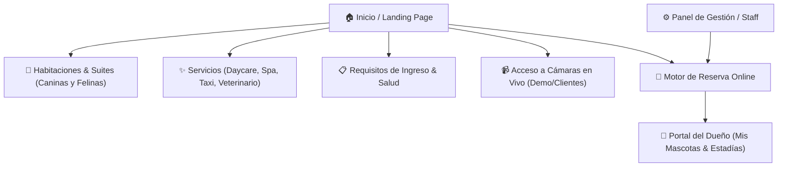
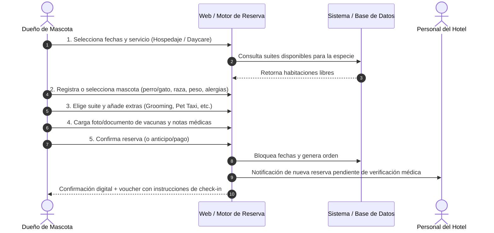
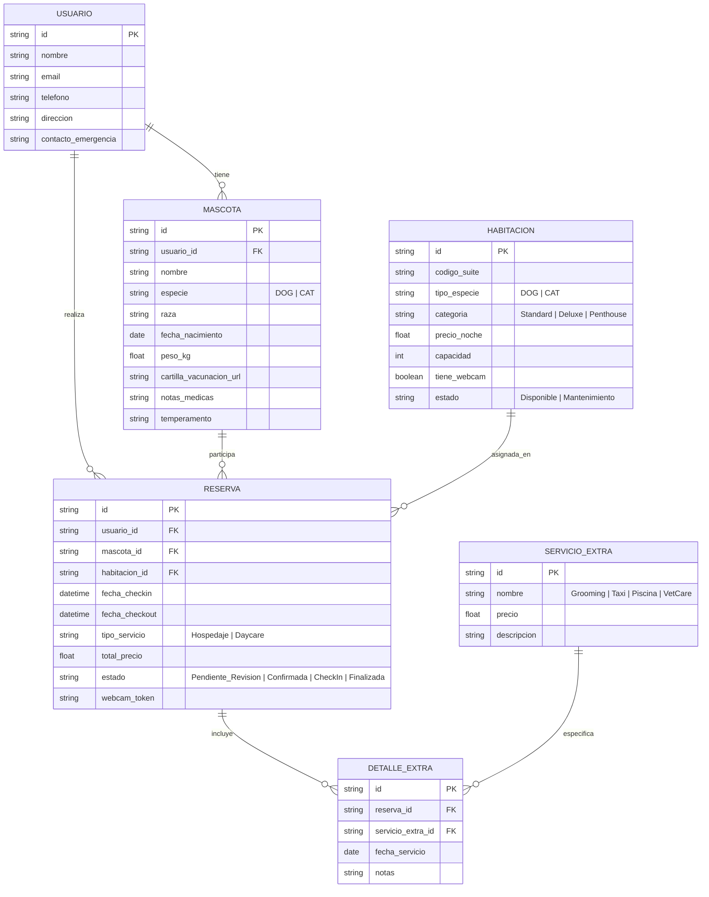

# Registro Consolidado del Proyecto: Plataforma Web Hotel de Mascotas
**Fecha de corte:** Noviembre 2026  
**Metodología:** Ingeniería de Software / SDD (*Software Design Description* - IEEE 1016 / ISO/IEC 42010)  
**Estado:** Fase de Especificación y Diseño (Cero código / Planificación previa)

---

## 1. Bitácora y Resumen de la Conversación

### 1.1. Inicio y Definición Inicial de Requerimientos
* El usuario solicitó la planificación de una página/plataforma para un **Hotel de Mascotas**.
* Mediante un relevamiento interactivo de requerimientos, se definieron los siguientes parámetros clave:
  1. **Alcance:** Plataforma web completa con sistema de reservas online automatizadas, disponibilidad de habitaciones en tiempo real y registro de perfiles de mascotas.
  2. **Especies admitidas:** **Perros y gatos** con áreas físicas, acústicas y visuales estrictamente separadas.
  3. **Servicios y diferenciales seleccionados:**
     * Peluquería, baño y spa (Grooming).
     * Guardería de día (*Daycare* sin pernocta).
     * Cámaras web en vivo (*Webcam streaming*) para supervisión por parte de los dueños.
     * Servicio veterinario y control de medicación 24/7.
     * Transporte / *Pet Taxi* (recogida y entrega a domicilio).
     * Actividades de recreación, piscina canina y adiestramiento.

### 1.2. Transición a Metodología de Ingeniería de Software (SDD)
* **Directriz del Usuario:** Se acordó expresamente **no iniciar la programación todavía**.
* **Enfoque adoptado:** Trabajar bajo **SDD (Software Design Document / Spec-Driven Development)**, priorizando análisis de requisitos, modelado formal de datos, arquitectura de componentes, concurrencia y seguridad antes de cualquier implementación de código.

### 1.3. Consulta de Archivos Locales del Usuario
* El usuario solicitó analizar el directorio local:
  `D:\Users\elgua\Documents\Programacion\PROYECTOS\hotel-mascotas-app`
* **Diagnóstico técnico:** El asistente opera dentro de una máquina virtual Linux remota y aislada en la nube, por lo que **no tiene acceso físico ni de red al disco local `D:\`** de la computadora del usuario.
* **Alternativas establecidas para importar el código/documentos previos:**
  1. Subir la carpeta comprimida en archivo `.zip` (excluyendo `node_modules` o carpetas pesadas de compilación) directamente en el chat.
  2. Conectar el repositorio de GitHub mediante la configuración de la plataforma.
  3. Copiar la estructura de directorios y contenido de archivos clave como texto en la conversación.

---

## 2. Plan Maestro de Diseño y Arquitectura de la Plataforma

### 2.1. Visión del Producto y Propuesta de Valor
Construir una plataforma de alta fidelidad que garantice:
* **Confianza y Transparencia:** Transmisión de cámaras en tiempo real con tokens seguros por reserva y bitácora diaria con fotos.
* **Seguridad Sanitaria:** Validación de cartillas de vacunación vigentes (Rabia, Séxtuple/Puppy para caninos; Triple Felina y Leucemia para felinos) y protocolos de medicación controlada.
* **Reserva sin Fricción:** Cálculo exacto de tarifas en función de fechas, especie, peso, categoría de suite y servicios adicionales.
* **Convivencia Controlada:** Diferenciación completa de circuitos para perros (parques, agility, piscina) y gatos (torres verticales, ambiente silencioso con feromonas Feliway).

---

### 2.2. Mapa del Sitio y Arquitectura de Información



#### Estructura de Secciones Públicas
1. **Header:** Selector directo de especie (Perros / Gatos), teléfono de emergencias veterinarias 24/7, botón de "Reservar Estadía" y acceso al Portal de Clientes.
2. **Hero con Buscador:** Formulario de búsqueda rápida por rango de fechas (check-in / check-out), especie de mascota y tipo de estadía (Hospedaje nocturno vs. Guardería de día).
3. **Catálogo de Habitaciones y Suites:**
   * *Caninas:* Estándar, Suites VIP con patio privado, suites climatizadas con cama ortopédica.
   * *Felinas:* Condominios verticales de múltiples niveles, rascadores de sisal, áreas aisladas de ruidos y olores de perros.
4. **Catálogo de Servicios Complementarios:**
   * *Spa & Grooming:* Baños terapéuticos, corte de raza, desenredado y corte de uñas.
   * *Guardería de Día (Daycare):* Socialización guiada y recreación diurna.
   * *Pet Taxi:* Traslados seguros en vehículos climatizados y con arneses/transportadoras homologadas.
   * *Atención Veterinaria 24/7:* Cuidados intensivos, administración de fármacos bajo receta.
   * *Piscina & Agility:* Recreación acuática supervisada y circuitos de estimulación.
5. **Requisitos de Admisión:**
   * Cartilla de vacunación completa y desparasitaciones al día.
   * Evaluación de temperamento para actividades en grupo.
6. **Módulo de Cámaras en Vivo:** Explicación técnica del acceso privado y seguro durante la estadía.
7. **Footer:** Ubicación física en mapa interactivo, políticas de cancelación, horarios de check-in/out y términos legales.

---

### 2.3. Flujo del Motor de Reservas (Booking Flow)



---

### 2.4. Modelo de Datos y Persistencia (Diagrama Entidad-Relación)



---

### 2.5. Módulos Especializados
* **Portal del Dueño:** Carnet sanitario digital, historial de reservas pasadas y futuras, reproductor de streaming WebRTC/HLS con token de sesión activo, bitácora fotográfica de la mascota.
* **Backoffice / Staff Panel:** Tablero de ocupación en tiempo real (evita colisiones/overbooking), semáforo clínico de alertas veterinarias y protocolo digital de recepción/entrega de pertenencias.

---

### 2.6. Pila Tecnológica Propuesta
* **Frontend:** React / Next.js, Tailwind CSS, Lucide Icons, React Hook Form con Zod.
* **Backend:** Node.js / Next.js API Routes / Express con arquitectura modular.
* **Base de Datos:** PostgreSQL o SQLite con transacciones ACID para reservas concurrentes.
* **Streaming de Video:** Protocolos WebRTC / HLS protegidos mediante tokens de acceso temporal.

---

## 3. Hoja de Ruta para el SDD (*Software Design Document*)

Para dar continuidad formal al proyecto bajo ingeniería de software, los capítulos a redactar en el SDD son:

```
[ ] Sección 1: Introducción, Alcance y Glosario de Términos del Dominio
[ ] Sección 2: Especificación Formal de Requisitos (SRS)
      - Requisitos Funcionales (RF-01 a RF-XX)
      - Requisitos No Funcionales (RNF: Rendimiento, Seguridad, Concurrencia, Confiabilidad)
[ ] Sección 3: Vistas Arquitectónicas del Sistema (C4 Model / 4+1)
      - Diagrama de Contexto (Nivel 1)
      - Diagrama de Contenedores (Nivel 2)
      - Diagrama de Componentes (Nivel 3)
[ ] Sección 4: Diseño Detallado de Datos y Estrategias de Concurrencia
      - Esquema Físico DDL
      - Mecanismos de Bloqueo (Optimistic/Pessimistic Locking contra overbooking)
[ ] Sección 5: Contratos de Interfaces y APIs (OpenAPI / REST)
[ ] Sección 6: Seguridad, Control de Acceso (RBAC) y Privacidad
[ ] Sección 7: Matriz de Trazabilidad de Requisitos y Plan de Pruebas
```

---

## 4. Archivos Generados en la Sesión

* **Documento Consolidado (este archivo):** `resumen_completo_hotel_mascotas.md`
* **Plan Maestro de Arquitectura y UX:** `plan_hotel_mascotas.md`
