# 📋 Plan Maestro de Especificación y Construcción del MVP
## Hotel Cápsula para Mascotas - Salta Capital (Tres Cerritos)
**Destinatario principal:** Demostración para Ezequiel (Dueño del Hotel)  
**Enfoque de diseño:** Mobile-First con Apple Human Interface Guidelines (HIG) y principios Mobile-Native.  
**Inspiración Arquitectónica y Visual:** [Hotel Horizonte Suites](https://github.com/azaeldahaka/Hotel-Horizonte-Suites.git).  
**Fecha:** Noviembre 2026  
**Estado:** Planificación y Especificación Previa a Implementación  

---

## 1. Objetivos del MVP

1. **Impactar y convencer a Ezequiel (Dueño):**
   - Demostrar cómo se automatiza la captación y cotización de clientes sin fricción por WhatsApp manual.
   - Demostrar el control total diario de sus **16 cápsulas individuales climatizadas** (10 caninas y 6 felinas) en Tres Cerritos.
   - Proveer un semáforo de bioseguridad para evitar problemas sanitarios y de convivencia.
2. **Selector de Vistas Instantáneo (Segmented Control Apple Glass):**
   - Alternar dinámicamente entre **Modo Cliente (Reserva y Voucher)** y **Panel de Ezequiel (Operación y Métricas)** con persistencia reactiva en memoria.
3. **Experiencia Nativa en Teléfonos Móviles:**
   - Cero retraso en taps, animaciones fluidas con respuesta a la presión física (`:active`), safe areas para iPhone (Dynamic Island / barra de inicio) y tipografía adaptable.

---

## 2. Stack Tecnológico Seleccionado

* **Entorno y Build Tool:** React 18 + TypeScript + Vite 6 (ultra rápido y liviano).
* **Estilos y Sistema de Diseño:** Tailwind CSS con tokens de diseño Apple (materiales translúcidos, blur, sombras suaves y curvas físicas).
* **Iconografía:** Lucide React (moderna, nítida y consistente).
* **Manejo de Fechas y Cálculos:** Date-fns (cálculo exacto de noches, días de guardería y horarios).
* **Estado y Persistencia Local:** React Context / Zustand / LocalStorage para que Ezequiel pueda interactuar en vivo, crear una reserva en la vista cliente y verla aparecer de inmediato en su panel administrativo sin requerir conexión a servidor externo.

---

## 3. Principios de Diseño: Mobile-First & Apple HIG

### 3.1. Fundamentos Mobile-Native (Inspirados en Emil Kowalski)
* **Viewport y Safe Areas:**
  * `<meta name="viewport" content="width=device-width, initial-scale=1, viewport-fit=cover, interactive-widget=resizes-content" />`
  * Uso de `100dvh` para la vista de la app y `100svh` para pantallas completas.
  * Respeto de notch y barra de navegación inferior mediante `padding-top: env(safe-area-inset-top)` y `padding-bottom: env(safe-area-inset-bottom)`.
* **Respuesta Táctil Inmediata:**
  * Eliminación del tap highlight azul/gris: `-webkit-tap-highlight-color: transparent`.
  * Eliminación del delay de 300ms: `touch-action: manipulation` en botones y controles.
  * Prevenir selección de texto accidental en botones: `user-select: none`.
  * Feedback físico en el instante de pulsar: `.button:active { transform: scale(0.97); transition: transform 100ms ease-out; }`.
* **Formularios sin Zoom Inesperado:**
  * Todos los inputs, selects y textareas tendrán `font-size: 16px` mínimo para impedir el auto-zoom intrusivo de Safari en iOS.

### 3.2. Estética y Materiales Apple (WWDC Fluid Interfaces)
* **Glassmorphism Funcional:** Barras de navegación flotantes y selector superior con `backdrop-filter: blur(20px)`, fondo `rgba(255, 255, 255, 0.75)` y borde de luz superior `border-t border-white/40`.
* **Bottom Sheets Nativos (Drawers):** El detalle de cada cápsula o mascota se abrirá desde la parte inferior como una hoja modal táctil deslizable, con curvatura superior (`rounded-t-3xl`) y handle de arrastre visual.
* **Tipografía Precisa:** Tracking óptico (`tracking-tight` en títulos grandes, neutro en cuerpo) y pesos jerárquicos claros.

---

## 4. Arquitectura de Módulos y Pantallas

```mermaid
flowchart TD
    Selector["🎛️ Apple Glass Segmented Control (Pill Flotante Superior)"]
    
    subgraph Cliente ["🐾 MODO CLIENTE (Experiencia Turista / Residente)"]
        Landing["🏠 Hero + Selector Perro / Gato + Emergencia 24/7"]
        Catalogo["🏨 Catálogo Visual de Cápsulas (Caninas C-01..10 / Felinas F-01..06)"]
        BookingWizard["📅 Motor de Reserva en 3 Pasos"]
        Step1["1. Fechas / Modalidad (Noche vs Daycare)"]
        Step2["2. Ficha de Mascota & Cartilla Sanitaria"]
        Step3["3. Adicionales (Spa, Pet Taxi, Piscina)"]
        Voucher["🎟️ Voucher Digital + QR + Botón WhatsApp Ezequiel"]
    end
    
    subgraph Owner ["👔 PANEL DE EZEQUIEL (Dashboard del Dueño)"]
        KPIs["📊 KPIs en Vivo (Ocupación %, Ingresos Hoy, Entradas/Salidas)"]
        CapsuleGrid["🏨 Grilla de 16 Cápsulas (10 Perros / 6 Gatos con estados)"]
        CapsuleModal["📱 Bottom Sheet: Ficha de Mascota, Check-in / Check-out"]
        ReservasTable["📋 Lista de Reservas con Filtros de Estado"]
        Semaforo["🛡️ Semáforo Sanitario (Vacunas al día / Alergias)"]
    end

    Selector -->|Tap: Cliente| Cliente
    Selector -->|Tap: Dueño| Owner
    Landing --> Catalogo --> BookingWizard
    BookingWizard --> Step1 --> Step2 --> Step3 --> Voucher
    KPIs --> CapsuleGrid --> CapsuleModal
    CapsuleGrid --> ReservasTable --> Semaforo
```

---

## 5. Especificación Detallada de Vistas

### 5.1. Selector de Modo Superior (Segmented Control)
* Posición: Fija superior, flotante y centrada con efecto de vidrio esmerilado (*Apple Glass Pill*).
* Opciones con iconos:
  * 🐶 **Modo Cliente (Reservas)**
  * 👔 **Panel de Ezequiel (Control Hotel)**
* Transición: Animación suave de deslizamiento de píldora activa.

---

### 5.2. Módulo 1: Vista Cliente (Experiencia de Reserva)
1. **Header & Contexto de Marca:**
   - Logotipo "Pet Capsule Hotel Salta".
   - Botón directo para emergencias veterinarias 24/7 en Tres Cerritos.
   - Switch de especie rápida: **Perros 🐕** / **Gatos 🐈**.
2. **Selector de Modalidad:**
   - **Hospedaje por Noches:** Check-in y check-out (ideal para viajes o turismo prolongado).
   - **Daycare / Guardería Diurna:** Por día u horas (clave para turistas durante excursiones al Tren a las Nubes, Salinas o Cafayate).
3. **Catálogo de Cápsulas:**
   - Tarjetas táctiles con fotografías ilustrativas de cápsulas individuales insonorizadas y climatizadas.
   - Badges de características: *Aislación acústica*, *Cámara HD*, *Cama ortopédica*, *Ventilación forzada*.
   - Indicador de precio por noche o por turno.
4. **Wizard de Reserva (Formulario Rápido Mobile-First):**
   - **Paso 1:** Fechas y horarios de ingreso/salida.
   - **Paso 2:** Perfil de la mascota:
     - Nombre de la mascota, especie, raza, peso aproximado en kg.
     - Notas de salud (alergias, medicación con horarios) y temperamento (sociable, temeroso, no reactivo).
     - Carga de libreta sanitaria (simulador con preview y verificación visual de vacuna antirrábica y séxtuple/triple felina).
   - **Paso 3:** Adicionales (Upselling del negocio de Ezequiel):
     - *Pet Spa & Grooming:* Baño relajante y corte higiénico.
     - *Pet Taxi:* Recogida o traslado en vehículo climatizado.
     - *Piscina & Agility canino:* Sesión de recreación acuática guiada.
5. **Voucher Digital & Confirmación:**
   - Resumen visual con código de reserva (ej: `#SALTA-2026-084`).
   - Ubicación en mapa de Tres Cerritos y recomendaciones de llegada.
   - Botón directo de WhatsApp: abre la app con el mensaje de confirmación precargado para Ezequiel.

---

### 5.3. Módulo 2: Panel de Control de Ezequiel (Dashboard del Dueño)
Inspirado en la solidez del dashboard de *Horizonte Suites*, adaptado a la operación del hotel de mascotas:

1. **Barra de KPIs Clave (Métricas en tiempo real):**
   - **Ocupación Actual:** Porcentaje y ratio (ej. *12 de 16 cápsulas ocupadas - 75%*).
   - **Ingresos Estimados del Día:** Total facturado por estadías + extras.
   - **Movimientos de Hoy:** Número de Check-ins y Check-outs programados.
   - **Alertas Médicas:** Mascotas con medicación especial o vacunas por validar.
2. **Grilla Visual de las 16 Cápsulas (El Inventario Físico):**
   - Sección A: **10 Cápsulas Caninas** (C-01 a C-10).
   - Sección B: **6 Cápsulas Felinas** (F-01 a F-06) - en sector acústicamente aislado.
   - Estados visuales:
     - 🟢 **Disponible:** Cápsula libre, limpia y lista.
     - 🔴 **Ocupada:** Nombre de la mascota, raza, foto/avatar y días restantes.
     - 🟡 **Reservada / Ingreso Hoy:** Mascota esperando check-in.
     - 🟣 **En Limpieza / Desinfección:** Protocolo post check-out.
3. **Bottom Sheet de Detalle de Cápsula (Apple Style Drawer):**
   - Al tocar cualquier cápsula ocupada o reservada, se abre un drawer suave desde abajo:
     - Foto de la mascota, nombre, dueño y teléfono.
     - Fechas de estadía y servicios extra contratados.
     - Alertas veterinarias y alimentación especial.
     - **Acciones con un tap:**
       - `[ Registrar Check-In ]` (cambia estado a ocupada).
       - `[ Registrar Check-Out ]` (libera la cápsula).
       - `[ Agregar Servicio Extra ]` (añadir baño de última hora).
       - `[ Contactar al Dueño ]` (abre WhatsApp o llamada).
4. **Gestión de Reservas y Tabla Filtrable:**
   - Filtros rápidos por estado: *Todas*, *Pendientes*, *Activas*, *Completadas*.
   - Buscador por nombre de mascota o cliente.
   - Botones rápidos de aprobación y cancelación.
5. **Semáforo Sanitario & Bioseguridad:**
   - Panel de control de cartillas sanitarias para auditar que ninguna mascota entre sin vacuna antirrábica o desparasitación al día.

---

## 6. Plan de Ejecución por Fases

| Fase | Tarea Principal | Entregable Concreto |
| :--- | :--- | :--- |
| **Fase 1** | **Inicialización & Setup** | Proyecto Vite + React + Tailwind + Lucide configurado en la raíz con baseline mobile-native (`100dvh`, safe areas, meta viewport). |
| **Fase 2** | **Capa de Datos Mock & Estado** | Mocks con 16 cápsulas, mascotas reales, reservas precargadas y store reactivo con soporte de persistencia local. |
| **Fase 3** | **Selector de Modo & Vista Cliente** | Segmented Control flotante, Landing de Tres Cerritos, catálogo canino/felino, wizard de reserva en 3 pasos y voucher con WhatsApp. |
| **Fase 4** | **Dashboard de Ezequiel (Dueño)** | Barra de KPIs, grilla visual de 16 cápsulas, bottom sheet interactivo de huésped, lista de reservas y semáforo sanitario. |
| **Fase 5** | **Polish Mobile & Verificación** | Pruebas de interacciones táctiles (`:active`), safe areas en mobile, responsive total y verificación de build sin errores. |

---

## 7. Criterios de Aceptación para la Demo con Ezequiel

1. **Prueba de Flujo Completo (Happy Path):**
   - El evaluador puede ingresar en la **Vista Cliente**, seleccionar fechas, cargar a su perro o gato, elegir la cápsula, añadir el Spa y confirmar la reserva.
   - Al cambiar al **Panel de Ezequiel** mediante el selector, la nueva reserva **aparece de inmediato en la grilla de 16 cápsulas** y actualiza los KPIs de ocupación e ingresos.
2. **Experiencia en Celular:**
   - No hay zoom no deseado en los inputs, no hay parpadeos grises en los toques, los botones responden al contacto físico y la navegación se siente como una app nativa de iOS/Android.
