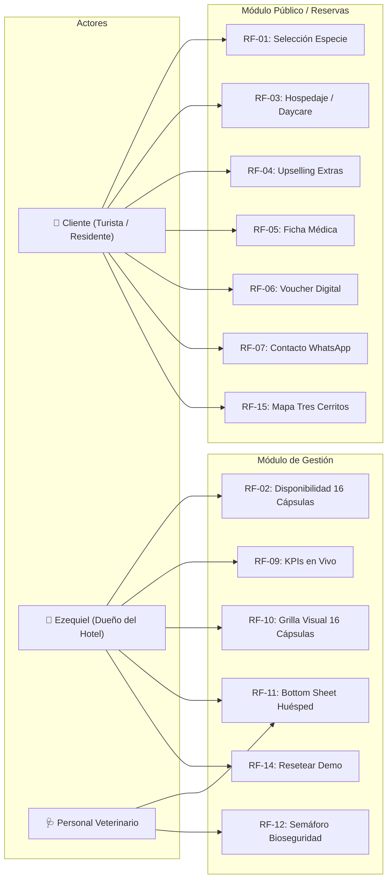

# 📋 Especificación Formal de Requisitos del Sistema (SRS)
## Plataforma Web & Motor de Gestión: Hotel Cápsula para Mascotas
**Norma:** IEEE 830 / ISO/IEC/IEEE 29148  
**Proyecto:** Hotel Cápsula para Mascotas (Salta Capital - Barrio Tres Cerritos)  
**Destinatarios:** Ezequiel (Dueño/Operador del Hotel), Turistas y Residentes  
**Estado:** Versión 1.0 (Aprobada / MVP Desplegado)  

---

## 1. Introducción y Propósito

El presente documento especifica formalmente los requisitos funcionales y no funcionales para la plataforma de reservas y gestión operativa del Hotel Cápsula para Mascotas ubicado en Barrio Tres Cerritos, Salta Capital.

El sistema resuelve la problemática de cuidado de mascotas tanto para el **turista receptivo** que visita Salta (y realiza excursiones como Tren a las Nubes, Cafayate o Cachi donde no se admiten animales) como para los **residentes locales** que requieren viajes laborales o de descanso con garantía de bioseguridad, supervisión veterinaria y control individual en 16 cápsulas climatizadas e insonorizadas.

---

## 2. Requisitos Funcionales (RF)

| Código | Nombre del Requisito | Descripción | Prioridad |
| :--- | :--- | :--- | :--- |
| **RF-01** | **Diferenciación Estricta de Especies** | El sistema debe aislar y clasificar en todo momento la experiencia de **Caninos (10 cápsulas)** y **Felinos (6 cápsulas)**, impidiendo reservas cruzadas en áreas incompatibles. | **Crítica** |
| **RF-02** | **Disponibilidad en Tiempo Real** | El motor de inventario debe calcular y reflejar instantáneamente el estado operativo de las 16 cápsulas (`DISPONIBLE`, `OCUPADA`, `RESERVADA`, `MANTENIMIENTO`). | **Crítica** |
| **RF-03** | **Doble Modalidad de Reserva** | Permitir la contratación de:  a) *Hospedaje Nocturno* (por rango de fechas check-in / check-out).  b) *Guardería Diurna (Daycare)* por horas o jornada para turistas en excursiones. | **Alta** |
| **RF-04** | **Cotización Dinámica y Upselling de Extras** | El sistema debe calcular en tiempo real la tarifa base sumando los servicios complementarios seleccionados (*Pet Spa/Baño*, *Pet Taxi*, *Piscina supervisada*, *Menú Barf/Gourmet*). | **Alta** |
| **RF-05** | **Ficha Sanitaria y Semáforo Clínico** | Registro obligatorio de datos médicos de la mascota: alergias, medicación con horarios, temperamento y validación de cartilla sanitaria (Antirrábica, Séxtuple o Triple Felina). | **Crítica** |
| **RF-06** | **Generación de Voucher Digital** | Emisión inmediata de un comprobante digital con código único de reserva (ej: `#SALTA-8901`), desglose de costos, fechas, instrucciones de ingreso y token de cámara. | **Alta** |
| **RF-07** | **Canal Directo de WhatsApp con Ezequiel** | Integración mediante protocolo `wa.me` que genera un mensaje preformateado listo para enviar al número del hotel con todos los datos de la reserva. | **Alta** |
| **RF-08** | **Acceso a Streaming de Cámaras HD** | Simulación y provisión de tokens de acceso efímeros asociados a la estadía para supervisar la cápsula en tiempo real durante el período contratado. | **Media** |
| **RF-09** | **Dashboard Operativo del Dueño (Ezequiel)** | Panel de control centralizado con 4 KPIs en vivo: % de ocupación, facturación estimada del día, cápsulas limpias listas y alertas clínicas activas. | **Crítica** |
| **RF-10** | **Grilla Visual del Inventario Físico** | Representación gráfica de las 16 cápsulas de Tres Cerritos con código de color (🟢 Verde, 🔴 Rojo, 🟡 Amarillo) y acceso con un toque al huésped. | **Crítica** |
| **RF-11** | **Hoja Inferior Táctil de Cápsula (Bottom Sheet)** | Despliegue interactivo tipo drawer para ver detalles del animal, dueño, alertas médicas y botones de acción rápida (`Check-In`, `Check-Out`, `Agregar Extra`). | **Alta** |
| **RF-12** | **Auditoría de Bioseguridad Sanitaria** | Pantalla de control clínico para verificar que ningún animal ingrese sin vacunas obligatorias al día, evitando focos de contagio en el hotel. | **Alta** |
| **RF-13** | **Selector de Modo Flotante (Apple Segmented Control)** | Control superior para alternar en cualquier momento entre la *Vista Clientes* y el *Panel de Ezequiel* sin perder el estado de la sesión. | **Media** |
| **RF-14** | **Restablecimiento de Datos Demo** | Botón para reiniciar los datos de prueba a su estado predeterminado y permitir demostraciones repetibles a clientes e inversores. | **Media** |
| **RF-15** | **Geolocalización & Guía de Accesibilidad** | Módulo con mapa cartográfico oficial de Tres Cerritos, croquis de líneas de transporte SAETA (5A, 5B, 8 Transversal) y botón directo a Google Maps. | **Alta** |

---

## 3. Requisitos No Funcionales (RNF)

| Código | Atributo de Calidad | Especificación Técnica |
| :--- | :--- | :--- |
| **RNF-01** | **Enfoque Mobile-Native** | Diseño responsive centrado en dispositivos móviles táctiles. Eliminación del tap-delay de 300ms (`touch-action: manipulation`), eliminación del parpadeo gris (`-webkit-tap-highlight-color: transparent`) y altura dinámica `100dvh`. |
| **RNF-02** | **Prevención de Zoom Intrusivo** | Todos los campos de formulario (`input`, `select`, `textarea`) tienen `font-size: 16px` como mínimo para evitar el zoom automático invasivo de Safari en iOS. |
| **RNF-03** | **Principios Apple HIG** | Materiales translúcidos con `backdrop-filter: blur(24px)`, feedback háptico/físico en pulsación (`:active { transform: scale(0.97) }`) y curvas de animación fluidas tipo resorte (*spring physics*). |
| **RNF-04** | **Rendimiento y Carga Rápida** | First Contentful Paint (FCP) < 1.0s y Time to Interactive (TTI) < 1.5s sobre redes móviles 4G. Assets optimizados y compresión Brotli/Gzip en Vercel Edge. |
| **RNF-05** | **Concurrencia y Consistencia ACID** | El modelo de datos garantiza que una cápsula no pueda ser reservada por dos clientes en el mismo rango de fechas (prevención de *overbooking*). |
| **RNF-06** | **Disponibilidad y Hosting Global** | Alojamiento en red perimetral (Vercel Edge Network) con disponibilidad del 99.9% y despliegue continuo (CI/CD) conectado al repositorio de GitHub. |
| **RNF-07** | **Seguridad y Privacidad** | Los tokens de streaming de cámaras son efímeros y están restringidos a la duración de la reserva confirmada. |
| **RNF-08** | **Resiliencia Local-First** | Persistencia automática en almacenamiento local (`LocalStorage`) que permite que la demostración funcione de manera robusta sin caídas por intermitencia de red. |

---

## 4. Matriz de Trazabilidad: Actores vs. Requisitos

